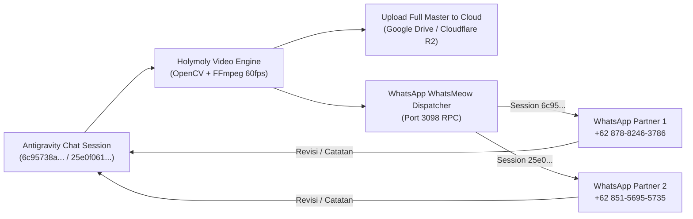

# 🎬 Holymoly Studio

Universal Headless AI Video Engine, Editing Studio, & Automated Preview Dispatch for **Antigravity**.  
Developed by **Halu Goods Indonesia**.

---

## 🚀 Overview

**Holymoly Studio** adalah engine produksi video komersial dan tutorial vertikal 9:16 (`1080x1920`) otomatis berstandar agensi tinggi untuk ekosistem **NUSA Kasir** dan aplikasi UMKM. Engine ini memadukan kekuatan **Google Flow MCP (Veo 3.1 & Imagen 3)**, **Vector Phone Mockup (Samsung Galaxy Z Flip 3)**, **Dual-Screen Workstation Compositing**, **OpenCV C-accelerated motion graphics**, dan **Gemini Native Audio TTS**.

---

## 💎 Standar Produksi & Directives Baku

Holymoly Studio memegang teguh 6 pilar standar tanpa kompromi (*Anti-Slop & Anti-Glitch*):

1. **Durasi 100% Dinamis & Narrative-Driven**:
   - Zero rigid duration template. Durasi video (15s, 30s, 45s, 60s, hingga 90s+) dan durasi beat ditentukan murni oleh alur cerita naskah dan forced alignment kata suara narator asli (1.0x native speed).
2. **Dual-Screen Workstation (HP + PC Browser)**:
   - Transisi mulus *shrink & descent* HP (`1.0x -> 0.42x`), zoom-out PC monitor, symmetrical midpoint glass LAN badge (`cy = 872`), kursor mouse taktil dengan ripple click, dan mobile touch tap ripple.
3. **Flow MCP Cinematic B-Roll**:
   - Kamera statis terkunci murni (*locked-off steady cam macro*), pemisahan fisik objek di meja (anti-glitch), dan sinkronisasi data riil mata uang Rupiah (`Rp`).
4. **Universal Pure Typography Subtitle (Rule 15)**:
   - Dilarang keras memakai container box / pill wrap di belakang teks subtitle. Wajib berupa tipografi melayang putih tebal dengan multi-layer deep drop shadow dan *word-by-word onset illumination*.
5. **Mastering Audio & Sound Design**:
   - Voiceover 1.0x native speed tanpa slowmo filter.
   - Ducking musik latar -7 dB saat vokal berbicara.
   - Hening seketika (*abrupt silence cut*) di punchline/outro.
   - Sinkronisasi transient SFX presisi milidetik.
6. **Pre-Delivery Agentic Audit Loop**:
   - Audit frame otomatis tiap beat, analisis waveform suara, dan pembersihan metadata C2PA sebelum disajikan ke pengguna.

---

## 📲 Automated WhatsApp Preview & Remote Partner Workflow

Untuk kolaborasi jarak jauh (remote partner) tanpa ketergantungan jaringan lokal:



- **Dispatcher Script**: [`engine/wa_dispatcher.py`](engine/wa_dispatcher.py)
  Mengirim pesan status, tautan Google Drive, deretan audit frames, dan video preview langsung ke WhatsApp partner.
- **Auto-Daemon Recovery**: Otomatis menyalakan `ezpzd.exe` di latar belakang bila belum aktif.

---

## 📂 Struktur Repositori

```
holymoly_studio/
├── engine/
│   ├── wa_dispatcher.py          # WhatsApp preview dispatcher (whatsmeow bridge)
│   ├── cleaner.py                # C2PA metadata cleaner & sanitizer
│   ├── bridge_server.py          # WebSocket / IPC bridge
│   ├── render_neuro_motion.py    # OpenCV compositing engine
│   └── project_manager.py        # Metadata & project settings
├── tutorial_studio/
│   └── runner/
│       ├── render_seamless_beat2_3.py   # Dual-screen workstation runner
│       ├── assemble_v8_aoede_master.py  # Master assembler (audio ducking + SSA subtitles)
│       ├── audit_final_video.py         # Automated pre-delivery audit
│       ├── generate_zflip3_frame.py     # Samsung Z Flip 3 vector mockup generator
│       ├── generate_grid_loop.py        # Infinite seamless scrolling grid loop
│       └── generate_screen_mask.py      # Lanczos rounded corner alpha mask
├── assets/                       # UI mockups, icons, SFX audio samples
├── config/                       # Audio presets, subtitle styles, color palettes
└── projects/                     # Multi-variant project files & scripts
```

---

## 🛠️ Instalasi & Menjalankan

1. **Persyaratan**:
   - Python 3.10+ (`cv2`, `numpy`, `requests`, `pillow`)
   - FFmpeg 6.0+ terpasang pada PATH sistem
   - WhatsApp daemon aktif via `ezpzpay/ezpzd.exe` (Port 3098)

2. **Kirim Preview ke WhatsApp via CLI**:
   ```bash
   python engine/wa_dispatcher.py text "+6287882463786" "Halo! Render video selesai."
   python engine/wa_dispatcher.py video "+6287882463786" "path/to/video.mp4" "Preview V8 Master"
   ```

---

## 📜 Lisensi
Hak Cipta © 2026 **Halu Goods Indonesia**. Seluruh hak cipta dilindungi undang-undang.
