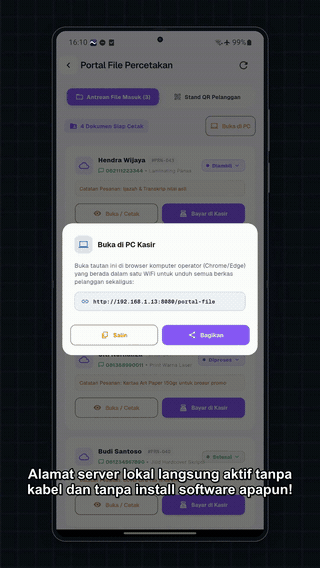
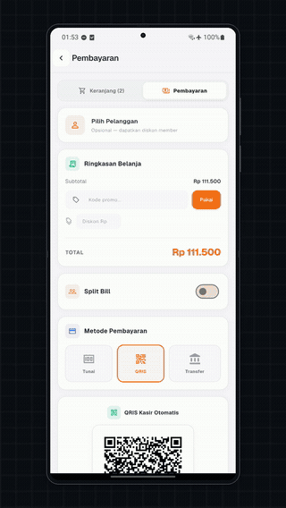
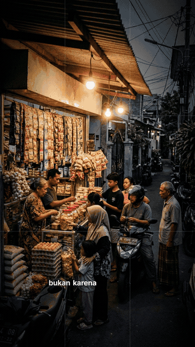
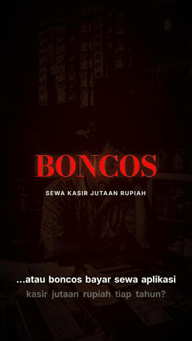
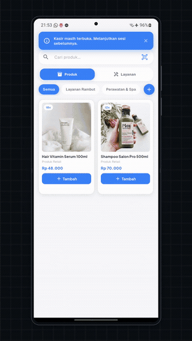
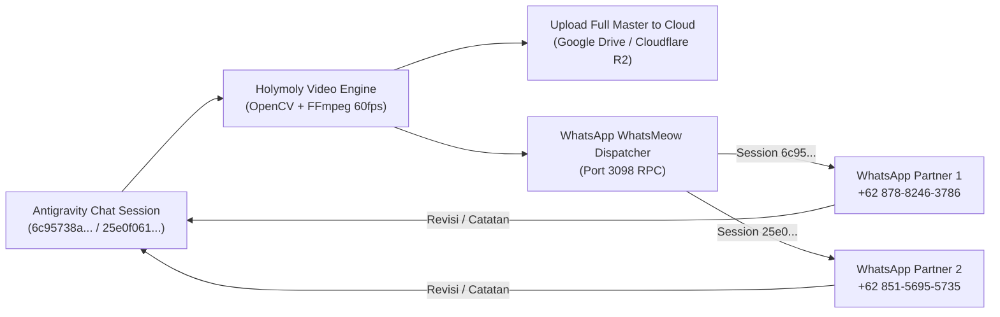

# 🎬 Holymoly Studio

Universal Headless AI Video Engine, Editing Studio, & Automated Preview Dispatch for **Antigravity**.  
Developed by **Halu Goods Indonesia**.

---

## 🚀 Overview

**Holymoly Studio** adalah engine produksi video komersial dan tutorial vertikal 9:16 (`1080x1920`) otomatis berstandar agensi tinggi untuk ekosistem **NUSA Kasir** dan aplikasi UMKM. Engine ini memadukan kekuatan **Google Flow MCP (Veo 3.1 & Imagen 3)**, **Vector Phone Mockup (Samsung Galaxy Z Flip 3)**, **Dual-Screen Workstation Compositing**, **OpenCV C-accelerated motion graphics**, dan **Gemini Native Audio TTS**.

---

## 📺 Flagship Showcase Gallery (Live Previews)

Berikut adalah kompilasi hasil video nyata yang diproduksi otomatis oleh **Holymoly Studio** menggunakan arketipe editing yang telah dilatih (*trained editing skills*). Setiap video menerapkan kanvas vertikal 9:16 (`1080x1920`), zero crop, forced alignment audio narator asli, dan tipografi murni tanpa boks slop.

| Arketipe & Skill | Live Preview (Animated) | Fitur Utama & Master Video |
| :--- | :---: | :--- |
| **Dual-Screen Workstation**<br>`@hm-pc-connect`<br>*NUSA Fotocopy (62s)* |  | • Transisi mulus HP mengecil & turun (`1.0x -> 0.42x`)<br>• PC browser meluncur turun dengan zoom keluar<br>• Midpoint glass LAN badge simetris (`152px`)<br>• Kursor taktil mouse click & mobile touch ripple<br>• Smart focal zoom `1.45x`<br><br>👉 [🎬 **Tonton Master 1080p (Google Drive)**](https://drive.google.com/file/d/1k6jcu5HwR8OpzfxWZqPB8QgV9ab9s8mN/view?usp=sharing) |
| **Cinematic Flow MCP Hybrid**<br>`@hm-flow-broll`<br>*NUSA Kelontong (60s)* |  | • Google Flow (Veo 3.1 & Imagen 3) B-Roll realistis<br>• Steady cam locked-off thermal printer macro<br>• Sinkronisasi checkout POS dengan kertas struk riil<br>• 100% Dynamic Duration & 1.0x Native VO<br>• Pure Typography floating subtitle<br><br>👉 [🎬 **Tonton Master 1080p (Google Drive)**](https://drive.google.com/file/d/1VphQXWb6L4maoovKA4TeSMd_Aljbf3bs/view?usp=sharing) |
| **Investigative Documentary**<br>`@hm-vox`<br>*NUSA Kasir Vox (30s)* |  | • In-Scene 4-Point Perspective Quad-Warp ke HP aktor<br>• Specular glass sheen & realistic corner radius<br>• Higienitas foto 100% fresh (Zero-recycle)<br>• Koreografi transient SFX & ducking musik -7 dB<br>• Pacing investigatif ala Vox / Johnny Harris<br><br>👉 [🎬 **Tonton Master 1080p (Google Drive)**](https://drive.google.com/file/d/1-uTEzAtM2dHrhLArBHgdnw9abpqWqt-F/view?usp=sharing) |
| **Fast Editorial Montage**<br>`@hm-montage`<br>*NUSA Proof-Hunting (35s)* |  | • 3x3 Tile Reveal & random flash entrance<br>• 2-Frame Strobe krisis per 66ms dengan difference box<br>• Sapuan stabilo kuning `#FFE04A` pada kartu tagihan<br>• Didone shock keyword masif 160px<br>• 3D perspective photo wall UMKM<br><br>👉 [🎬 **Tonton Master 1080p (Google Drive)**](https://drive.google.com/file/d/1r1uVuH-2_Q7I-gCeN5yCT4MU4ofRJH44/view?usp=sharing) |
| **Basic Mockup Demo**<br>`@hm-mockup`<br>*NUSA Salon (25s)* |  | • Vector Samsung Galaxy Z Flip 3 frame terpusat (`cx=540, cy=960`)<br>• Infinite seamless scrolling blurred grid background<br>• Zero Crop: status bar jam/wifi hingga navigasi bawah utuh<br>• Punch-in camera zoom terarah ke tap points<br>• Zero Subtitle Slop (mode demo elegan)<br><br>👉 [🎬 **Tonton Master 1080p (Google Drive)**](https://drive.google.com/file/d/1A1J4zdH7EZ1RTvmuobjh_CKqqb2zTkkr/view?usp=sharing) |

> 📁 **Arsip Lengkap Seluruh Master Output Video:**  
> [**Buka Folder Google Drive Holymoly Studio**](https://drive.google.com/drive/folders/14CIAznZOlM9NWapNg9w1Y2WA-raJzUTv?usp=sharing) (Akun `nusabyhalugoodsindonesia@gmail.com`)

---

## 💎 Standar Produksi & Directives Baku

Holymoly Studio memegang teguh 6 pilar standar tanpa kompromi (*Anti-Slop & Anti-Glitch*):

1. **Durasi 100% Dinamis & Narrative-Driven**:
   - Zero rigid duration template. Durasi video (15s, 30s, 45s, 60s, hingga 90s+) dan durasi beat ditentukan murni oleh alur cerita naskah dan forced alignment kata suara narator asli (1.0x native speed).
2. **Dual-Screen Workstation (HP + PC Browser)**:
   - Transisi mulus *shrink & descent* HP (`1.0x -> 0.42x`), zoom-out PC monitor, symmetrical midpoint glass LAN badge (`cy = 872`), kursor mouse taktil dengan ripple click, dan mobile touch tap ripple.
3. **Flow MCP Cinematic B-Roll**:
   - Kamera statis terkunci murni (*locked-off steady cam macro*), pemisahan fisik objek di meja (anti-glitch), dan sinkronisasi data riil mata uang Rupiah (`Rp`).
4. **Universal Pure Typography Subtitle (Rule 15)**:
   - Dilarang keras memakai container box / pill wrap di belakang teks subtitle. Wajib berupa tipografi melayang putih tebal dengan multi-layer deep drop shadow dan *word-by-word onset illumination*.
5. **Mastering Audio & Sound Design**:
   - Voiceover 1.0x native speed tanpa slowmo filter.
   - Ducking musik latar -7 dB saat vokal berbicara.
   - Hening seketika (*abrupt silence cut*) di punchline/outro.
   - Sinkronisasi transient SFX presisi milidetik.
6. **Pre-Delivery Agentic Audit Loop**:
   - Audit frame otomatis tiap beat, analisis waveform suara, dan pembersihan metadata C2PA sebelum disajikan ke pengguna.

---

## 🧠 7 Trained Editing Skills

Koleksi skill editing yang telah dilatih dan terintegrasi dalam Antigravity:

| Skill | Prefix | Deskripsi & Fungsi |
| :--- | :--- | :--- |
| `@hm-editor-persona` | `hm-` | Persona Senior Creative Video Director & Master Editor Holymoly Studio |
| `@hm-pc-connect` | `hm-` | Arketipe Dual-Screen Workstation (PC Browser + HP Z Flip 3 + LAN Badge) |
| `@hm-flow-broll` | `hm-` | Arketipe Cinematic Flow MCP B-Roll bergantian dengan Device Mockup |
| `@hm-vox` | `hm-` | Arketipe Video Komersial Dokumenter Investigatif 9:16 (Vox / Johnny Harris) |
| `@hm-montage` | `hm-` | Arketipe Video Editorial Montage Cepat & Proof-Hunting 9:16 |
| `@hm-mockup` | `hm-` | Arketipe Template Basic Mockup HP Z Flip 3 terpusat + Infinite Scrolling Grid |
| `@hm-holymoly-studio` | `hm-` | Core universal headless video engine & pipeline coordinator |

---

## 📲 Automated WhatsApp Preview & Remote Partner Workflow

Untuk kolaborasi jarak jauh (remote partner) tanpa ketergantungan jaringan lokal:



- **Dispatcher Script**: [`engine/wa_dispatcher.py`](engine/wa_dispatcher.py)
  Mengirim pesan status, tautan Google Drive, deretan audit frames, dan video preview langsung ke WhatsApp partner.
- **Auto-Daemon Recovery**: Otomatis menyalakan `ezpzd.exe` di latar belakang bila belum aktif.

---

## 📂 Struktur Repositori

```
holymoly_studio/
├── assets/
│   ├── showcase/                 # Live animated GIF showcase gallery (README)
│   ├── zflip3_body_pure.png      # Samsung Galaxy Z Flip 3 frame
│   ├── zflip3_screen_mask.png    # Alpha rounded corner mask
│   └── sfx/                      # Transient sound effects (click, whoosh, swish)
├── engine/
│   ├── wa_dispatcher.py          # WhatsApp preview dispatcher (whatsmeow bridge)
│   ├── gdrive_sync.py            # Google Drive automated upload & sharing
│   ├── cleaner.py                # C2PA metadata cleaner & sanitizer
│   ├── bridge_server.py          # WebSocket / IPC bridge
│   ├── render_neuro_motion.py    # OpenCV compositing engine
│   └── project_manager.py        # Metadata & project settings
├── tutorial_studio/
│   └── runner/
│       ├── render_seamless_beat2_3.py   # Dual-screen workstation runner
│       ├── assemble_v8_aoede_master.py  # Master assembler (audio ducking + SSA subtitles)
│       ├── audit_final_video.py         # Automated pre-delivery audit
│       ├── generate_zflip3_frame.py     # Samsung Z Flip 3 vector mockup generator
│       ├── generate_grid_loop.py        # Infinite seamless scrolling grid loop
│       └── generate_screen_mask.py      # Lanczos rounded corner alpha mask
├── config/                       # Audio presets, subtitle styles, color palettes
└── projects/                     # Multi-variant project files & scripts
```

---

## 🛠️ Instalasi & Menjalankan

1. **Persyaratan**:
   - Python 3.10+ (`cv2`, `numpy`, `requests`, `pillow`)
   - FFmpeg 6.0+ terpasang pada PATH sistem
   - WhatsApp daemon aktif via `ezpzpay/ezpzd.exe` (Port 3098)

2. **Kirim Preview ke WhatsApp via CLI**:
   ```bash
   python engine/wa_dispatcher.py text "+6287882463786" "Halo! Render video selesai."
   python engine/wa_dispatcher.py video "+6287882463786" "path/to/video.mp4" "Preview V8 Master"
   ```

---

## 📜 Lisensi
Hak Cipta © 2026 **Halu Goods Indonesia**. Seluruh hak cipta dilindungi undang-undang.
